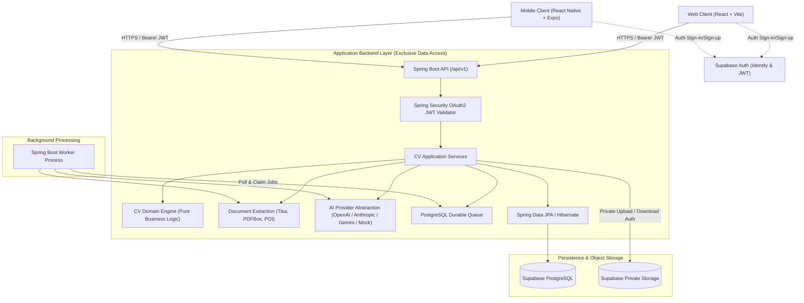
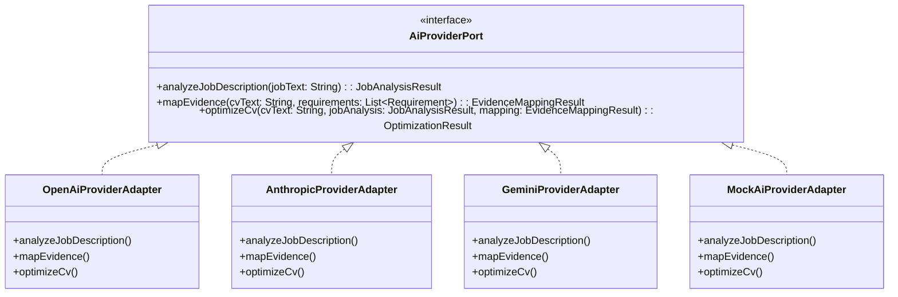
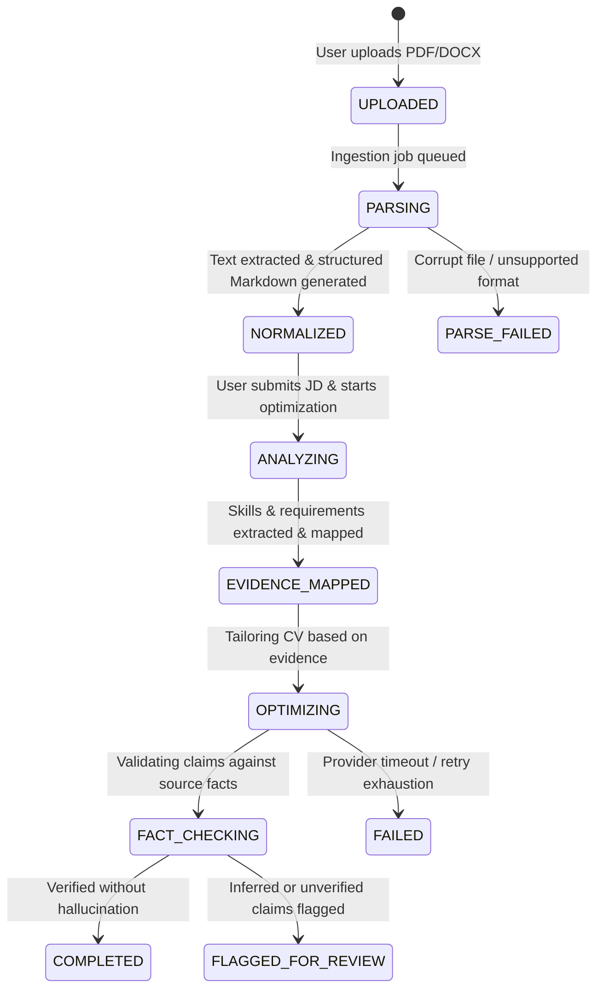

# Architecture Specification — Rysoo CV Optimization Platform

## 1. High-Level System Overview

Rysoo is a multi-tier, AI-powered CV optimization platform that enables job seekers to tailor their resumes against target job descriptions while guaranteeing factual fidelity.

---

## 2. Mandatory Architecture Rule: Option A

The platform strictly adheres to **Option A**:
1. **Spring Boot is the exclusive application data access layer.**
2. Frontend and mobile clients never connect directly to application tables in PostgreSQL via Supabase PostgREST or supabase-js database clients.
3. Supabase Auth is utilized purely as an identity provider:
   - Client authenticates with Supabase Auth -> receives access token (JWT).
   - Client attaches `Authorization: Bearer <token>` to all HTTP calls to Spring Boot.
4. Spring Boot:
   - Validates JWT signature against Supabase public keys (JWKS / RS256/ES256/HS256).
   - Verifies issuer, audience, and expiration.
   - Extracts `sub` (authenticated user UUID).
   - Enforces ownership on every query and mutation (`WHERE user_id = :userId`).
   - Issues short-lived pre-signed URLs for file uploads/downloads from Supabase Storage after verifying ownership.
   - Enforces quotas, rate limits, and business invariants.

---

## 3. Monorepo Organization & Component Boundaries

- **`apps/api`**: Spring Boot application entry point exposing REST endpoints under `/api/v1`.
- **`apps/worker`**: Dedicated daemon entry point executing background queue consumers for document extraction, OCR fallback, AI optimization, and export generation.
- **`apps/web`**: Single-Page Application built with React 19, TypeScript (strict), Vite, and modern aesthetic styling tokens. Incorporates root brand assets (`logo.svg`, `logo.png`, `favicon.ico`).
- **`apps/mobile`**: React Native mobile app using Expo SDK, sharing contract types and API schemas with the web application.
- **`services/cv-domain`**: Pure Java domain entities, value objects, domain events, and repository interfaces. Completely decoupled from Spring, JPA, and AI SDKs.
- **`services/cv-application`**: Orchestration use cases (e.g., `OptimizeCvUseCase`, `NormalizeCvUseCase`), transaction boundaries, DTO mappings.
- **`services/cv-infrastructure`**: Database persistence entities, Spring Data JPA repositories, Flyway migrations, Supabase storage adapter, and background queue implementation.
- **`services/cv-document-processing`**: Apache Tika, Apache PDFBox, Apache POI, and OCR integration for parsing DOCX/PDF to structured Markdown and AST.
- **`packages/contracts`**: Shared TypeScript definitions for API request/response payloads, enum states, and validation schemas.
- **`packages/api-client`**: Generated OpenAPI client for type-safe network interactions.

---

## 4. Provider-Agnostic AI Integration Architecture

To ensure vendor neutrality and prevent vendor lock-in, the system decouples domain logic from AI providers:

### Prompt Guardrails & Anti-Fabrication Principles
- Prompts enforce strict extraction and tailoring from provided context only.
- Strict schema validation on model output JSON.
- Deterministic verification: Extracted employers, dates, qualifications, and metrics from optimized outputs are cross-checked against source CV facts. Unsupported facts trigger rejection or manual review flags.

---

## 5. Processing Status & Lifecycle Transitions

