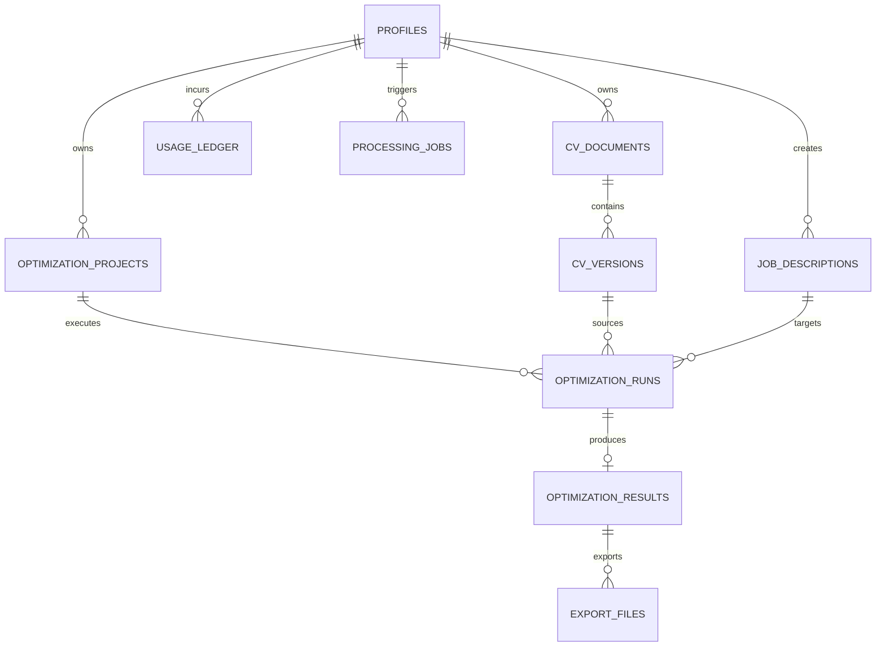

# Data Model Specification — Rysoo CV Optimization Platform

## 1. Domain Entities & Relationships

The data model uses UUIDs as primary keys, explicit foreign key ownership constraints to `profiles(id)`, timestamp audit columns (`created_at`, `updated_at`), and status tracking.

---

## 2. Entity Definitions

### 1. `profiles`
Represents the authenticated user profile matching Supabase Auth `auth.users.id`.
- `id` (UUID, PK) — Matches Supabase Auth user UUID (`sub`).
- `email` (VARCHAR(255), NOT NULL, UNIQUE).
- `full_name` (VARCHAR(255)).
- `created_at` (TIMESTAMPTZ, NOT NULL, DEFAULT NOW()).
- `updated_at` (TIMESTAMPTZ, NOT NULL, DEFAULT NOW()).
- `is_active` (BOOLEAN, NOT NULL, DEFAULT TRUE).

### 2. `cv_documents`
Represents a CV document container owned by a user.
- `id` (UUID, PK, DEFAULT gen_random_uuid()).
- `user_id` (UUID, NOT NULL, FK -> profiles.id ON DELETE CASCADE).
- `title` (VARCHAR(255), NOT NULL).
- `created_at` (TIMESTAMPTZ, NOT NULL, DEFAULT NOW()).
- `updated_at` (TIMESTAMPTZ, NOT NULL, DEFAULT NOW()).
- `archived_at` (TIMESTAMPTZ, NULL).

### 3. `cv_versions`
An immutable version of a CV document representing original uploaded file or normalized/edited Markdown.
- `id` (UUID, PK, DEFAULT gen_random_uuid()).
- `cv_document_id` (UUID, NOT NULL, FK -> cv_documents.id ON DELETE CASCADE).
- `version_number` (INT, NOT NULL).
- `version_type` (VARCHAR(32), NOT NULL) — `ORIGINAL_UPLOAD`, `NORMALIZED_MARKDOWN`, `MANUALLY_EDITED`, `OPTIMIZED`.
- `storage_path` (VARCHAR(512), NULL) — Private Supabase Storage object key for binary (PDF/DOCX).
- `file_name` (VARCHAR(255), NULL).
- `file_size_bytes` (BIGINT, NULL).
- `mime_type` (VARCHAR(128), NULL).
- `content_hash_sha256` (VARCHAR(64), NOT NULL).
- `raw_text` (TEXT, NULL).
- `normalized_markdown` (TEXT, NOT NULL).
- `structured_ast_json` (JSONB, NOT NULL DEFAULT '{}'::jsonb).
- `created_at` (TIMESTAMPTZ, NOT NULL, DEFAULT NOW()).
- **Unique Constraint**: `(cv_document_id, version_number)`.

### 4. `job_descriptions`
Job vacancy descriptions entered or uploaded by the user.
- `id` (UUID, PK, DEFAULT gen_random_uuid()).
- `user_id` (UUID, NOT NULL, FK -> profiles.id ON DELETE CASCADE).
- `target_role` (VARCHAR(255), NOT NULL).
- `target_company` (VARCHAR(255), NULL).
- `raw_text` (TEXT, NOT NULL).
- `parsed_requirements_json` (JSONB, NOT NULL DEFAULT '{}'::jsonb).
- `created_at` (TIMESTAMPTZ, NOT NULL, DEFAULT NOW()).
- `updated_at` (TIMESTAMPTZ, NOT NULL, DEFAULT NOW()).

### 5. `optimization_projects`
A workspace associating a CV document with a target job description for iterative optimization.
- `id` (UUID, PK, DEFAULT gen_random_uuid()).
- `user_id` (UUID, NOT NULL, FK -> profiles.id ON DELETE CASCADE).
- `cv_document_id` (UUID, NOT NULL, FK -> cv_documents.id ON DELETE CASCADE).
- `job_description_id` (UUID, NOT NULL, FK -> job_descriptions.id ON DELETE CASCADE).
- `name` (VARCHAR(255), NOT NULL).
- `created_at` (TIMESTAMPTZ, NOT NULL, DEFAULT NOW()).
- `updated_at` (TIMESTAMPTZ, NOT NULL, DEFAULT NOW()).

### 6. `optimization_runs`
An individual execution of the AI optimization engine.
- `id` (UUID, PK, DEFAULT gen_random_uuid()).
- `project_id` (UUID, NOT NULL, FK -> optimization_projects.id ON DELETE CASCADE).
- `source_cv_version_id` (UUID, NOT NULL, FK -> cv_versions.id ON DELETE RESTRICT).
- `job_description_id` (UUID, NOT NULL, FK -> job_descriptions.id ON DELETE RESTRICT).
- `ai_provider` (VARCHAR(64), NOT NULL) — e.g., `openai`, `anthropic`, `gemini`, `mock`.
- `ai_model_identifier` (VARCHAR(128), NOT NULL).
- `prompt_version` (VARCHAR(32), NOT NULL).
- `status` (VARCHAR(32), NOT NULL) — `QUEUED`, `PROCESSING`, `COMPLETED`, `FAILED`, `CANCELLED`.
- `attempt_count` (INT, NOT NULL DEFAULT 0).
- `token_usage_input` (INT, NOT NULL DEFAULT 0).
- `token_usage_output` (INT, NOT NULL DEFAULT 0).
- `estimated_cost_usd` (NUMERIC(10, 6), NOT NULL DEFAULT 0.000000).
- `error_code` (VARCHAR(64), NULL).
- `sanitized_error_message` (TEXT, NULL).
- `started_at` (TIMESTAMPTZ, NULL).
- `completed_at` (TIMESTAMPTZ, NULL).
- `created_at` (TIMESTAMPTZ, NOT NULL, DEFAULT NOW()).

### 7. `optimization_results`
Output produced by a successful optimization run.
- `id` (UUID, PK, DEFAULT gen_random_uuid()).
- `optimization_run_id` (UUID, NOT NULL UNIQUE, FK -> optimization_runs.id ON DELETE CASCADE).
- `tailored_markdown` (TEXT, NOT NULL).
- `evidence_mapping_json` (JSONB, NOT NULL) — `{ demonstrated: [], partially_supported: [], missing: [] }`.
- `match_score_percentage` (INT, NOT NULL).
- `match_explanation_markdown` (TEXT, NOT NULL).
- `factual_verification_status` (VARCHAR(32), NOT NULL) — `PASSED`, `FLAGGED_INCONSISTENCIES`.
- `verification_report_json` (JSONB, NOT NULL DEFAULT '{}'::jsonb).
- `diff_summary_json` (JSONB, NOT NULL DEFAULT '{}'::jsonb).
- `created_at` (TIMESTAMPTZ, NOT NULL, DEFAULT NOW()).

### 8. `export_files`
Rendered export artifacts (PDF, DOCX, Markdown).
- `id` (UUID, PK, DEFAULT gen_random_uuid()).
- `user_id` (UUID, NOT NULL, FK -> profiles.id ON DELETE CASCADE).
- `optimization_result_id` (UUID, NOT NULL, FK -> optimization_results.id ON DELETE CASCADE).
- `format` (VARCHAR(16), NOT NULL) — `PDF`, `DOCX`, `MARKDOWN`.
- `storage_path` (VARCHAR(512), NOT NULL).
- `file_name` (VARCHAR(255), NOT NULL).
- `file_size_bytes` (BIGINT, NOT NULL).
- `mime_type` (VARCHAR(128), NOT NULL).
- `download_count` (INT, NOT NULL DEFAULT 0).
- `created_at` (TIMESTAMPTZ, NOT NULL, DEFAULT NOW()).

### 9. `usage_ledger`
Audit log tracking user quotas and credit consumption.
- `id` (UUID, PK, DEFAULT gen_random_uuid()).
- `user_id` (UUID, NOT NULL, FK -> profiles.id ON DELETE CASCADE).
- `operation_type` (VARCHAR(64), NOT NULL) — `PARSE_DOCUMENT`, `OPTIMIZE_CV`, `EXPORT_DOCUMENT`.
- `reference_id` (UUID, NULL).
- `units_consumed` (INT, NOT NULL DEFAULT 1).
- `estimated_cost_usd` (NUMERIC(10, 6), NOT NULL DEFAULT 0.000000).
- `metadata_json` (JSONB, NOT NULL DEFAULT '{}'::jsonb).
- `created_at` (TIMESTAMPTZ, NOT NULL, DEFAULT NOW()).

### 10. `processing_jobs`
Durable PostgreSQL background queue table.
- `id` (UUID, PK, DEFAULT gen_random_uuid()).
- `job_type` (VARCHAR(64), NOT NULL) — `DOCUMENT_INGESTION`, `CV_OPTIMIZATION`, `EXPORT_GENERATION`.
- `user_id` (UUID, NOT NULL, FK -> profiles.id ON DELETE CASCADE).
- `payload_json` (JSONB, NOT NULL).
- `status` (VARCHAR(32), NOT NULL DEFAULT 'QUEUED') — `QUEUED`, `PROCESSING`, `RETRYING`, `COMPLETED`, `FAILED`.
- `priority` (INT, NOT NULL DEFAULT 0).
- `idempotency_key` (VARCHAR(255), NOT NULL UNIQUE).
- `attempt_count` (INT, NOT NULL DEFAULT 0).
- `max_retries` (INT, NOT NULL DEFAULT 3).
- `next_run_at` (TIMESTAMPTZ, NOT NULL DEFAULT NOW()).
- `locked_at` (TIMESTAMPTZ, NULL).
- `locked_by` (VARCHAR(128), NULL).
- `created_at` (TIMESTAMPTZ, NOT NULL, DEFAULT NOW()).
- `updated_at` (TIMESTAMPTZ, NOT NULL, DEFAULT NOW()).

---

## 3. Database Indexes

- `idx_cv_documents_user_id`: `cv_documents(user_id)`.
- `idx_cv_versions_doc_ver`: `cv_versions(cv_document_id, version_number)`.
- `idx_job_descriptions_user_id`: `job_descriptions(user_id)`.
- `idx_opt_projects_user_id`: `optimization_projects(user_id)`.
- `idx_opt_runs_project_id`: `optimization_runs(project_id)`.
- `idx_opt_runs_status`: `optimization_runs(status)`.
- `idx_export_files_user_id`: `export_files(user_id)`.
- `idx_usage_ledger_user_id`: `usage_ledger(user_id, created_at)`.
- `idx_jobs_queue_poll`: `processing_jobs(status, next_run_at, priority DESC)` where `status IN ('QUEUED', 'RETRYING')`.

---

## 4. Deletion Strategy & GDPR Compliance

- Cascading deletes ensure that when a user requests account deletion, all dependent CVs, versions, optimization projects, runs, results, and export references are removed transactionally.
- Supabase Storage object cleanup hooks queue background jobs to purge physical binary files from private storage buckets.
