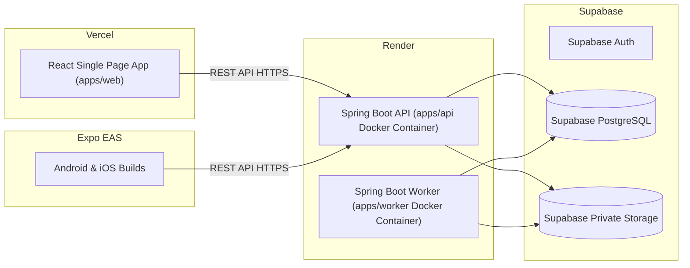

# Deployment Architecture & Configuration — Rysoo CV Optimization Platform

## 1. Hosting Architecture Overview

---

## 2. Render Blueprint Specification (`render.yaml`)

Both the REST API and background Worker run as Render Web Service and Background Worker instances built from a single multi-stage `Dockerfile`:
- **API Service**:
  - Service Type: `web`
  - Runtime: `docker`
  - DockerfilePath: `./Dockerfile`
  - DockerContext: `.`
  - Health Check: `/actuator/health`
  - Start Command: `java -jar -Dspring.profiles.active=render /app/api.jar`
- **Worker Service**:
  - Service Type: `worker`
  - Runtime: `docker`
  - Start Command: `java -jar -Dspring.profiles.active=render,worker /app/worker.jar`

---

## 3. Multi-Stage Dockerfile Architecture

To ensure reproducible, lightweight, and secure container images:
1. **Stage 1 (Builder)**: Eclipse Temurin OpenJDK 21 (or 24 for compatible build), caches Maven dependencies, builds JAR artifacts for `apps/api` and `apps/worker`.
2. **Stage 2 (Runtime)**: Eclipse Temurin JRE Alpine/Distroless image, non-root user `appuser:appgroup`, copied executable fat JARs, minimal footprint, hardened OS.

---

## 4. Vercel Frontend Deployment

- **Root Directory**: `.` (monorepo root) or `apps/web`.
- **Framework**: Vite.
- **Build Command**: `npm run build --workspace=apps/web`.
- **Output Directory**: `apps/web/dist`.
- **Environment Variables**:
  - `VITE_SUPABASE_URL`: Public Supabase Project URL.
  - `VITE_SUPABASE_ANON_KEY`: Public Supabase Anonymous Key.
  - `VITE_API_BASE_URL`: Render Backend API Public URL.

---

## 5. Expo EAS Mobile Deployment

- Configured via `apps/mobile/eas.json`.
- Profiles: `development`, `preview`, `production`.
- Environment variables injected via EAS Secrets:
  - `EXPO_PUBLIC_SUPABASE_URL`
  - `EXPO_PUBLIC_SUPABASE_ANON_KEY`
  - `EXPO_PUBLIC_API_BASE_URL`

---

## 6. Migration & Database Rollout Strategy

- Migrations are version-controlled in `supabase/migrations/` and executed via **Flyway** on application startup or in a standalone CI pre-deploy step.
- Migrations are strictly forward-compatible:
  - Additive changes (new tables, nullable columns) applied first.
  - Application code deployed.
  - Deprecated columns dropped only in subsequent releases.
