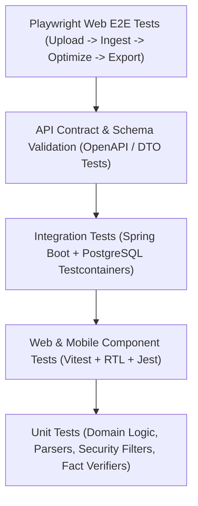

# Testing Strategy & Quality Assurance — Rysoo CV Optimization Platform

## 1. Multi-Tier Testing Pyramid

---

## 2. Backend Testing Standards

- **Unit Testing**:
  - Pure domain rules in `services/cv-domain` tested without Spring Context.
  - Document parser extraction logic tested against representative byte streams.
  - Fact-checking engine tested with intentionally fabricated claims to verify rejection.
- **Integration Testing**:
  - `@SpringBootTest` with `@AutoConfigureMockMvc`.
  - **Testcontainers**: Real PostgreSQL instance spun up in Docker for database tests, ensuring Flyway migrations and JSONB queries execute identically to production.
  - Security tests verifying:
    - Expired JWT -> `401 Unauthorized`.
    - Token with wrong issuer -> `401 Unauthorized`.
    - Requesting another user's CV -> `404 Not Found`.
    - Tampered payload -> validation errors.
- **AI Mocking**:
  - `MockAiProviderAdapter` used during automated test runs to provide deterministic, instantaneous, zero-cost AI responses.
  - Rate limiting and timeout simulation tests.

---

## 3. Web & Mobile Testing Standards

- **React Web (`apps/web`)**:
  - **Vitest & React Testing Library**: Component rendering, markdown editing, upload progress, error boundaries, state management.
  - **Playwright**: End-to-end user journeys in headless Chromium/Firefox/WebKit:
    1. User login.
    2. Document upload.
    3. Markdown normalization view & edit.
    4. Target job description entry.
    5. Run optimization.
    6. View requirement gap analysis and diff comparison.
    7. Export download.
- **React Native Mobile (`apps/mobile`)**:
  - **Jest & React Native Testing Library**: Screen rendering, form inputs, secure token storage mocks, offline status handling.

---

## 4. Synthetic Test Fixtures

All fixtures in `tests/fixtures/` are strictly synthetic. No real person's personal identifiable information (PII) is ever used:
1. `synthetic-resume-valid.docx`: Standard multi-page DOCX with Work Experience, Education, and Skills.
2. `synthetic-resume-valid.pdf`: Standard digital vector PDF with structured headings.
3. `synthetic-resume-scanned.pdf`: Image-based scanned PDF to trigger OCR fallback.
4. `synthetic-resume-corrupt.docx`: Truncated zip archive to test parser error recovery.
5. `synthetic-resume-prompt-injection.pdf`: Contains embedded adversarial prompts attempting to force 100% score.
6. `job-description-standard.txt`: Full-stack engineering job description.
7. `job-description-mismatched.txt`: Job description requiring skills completely absent from synthetic CV.
8. `job-description-empty.txt`: Empty text to test input validation.
