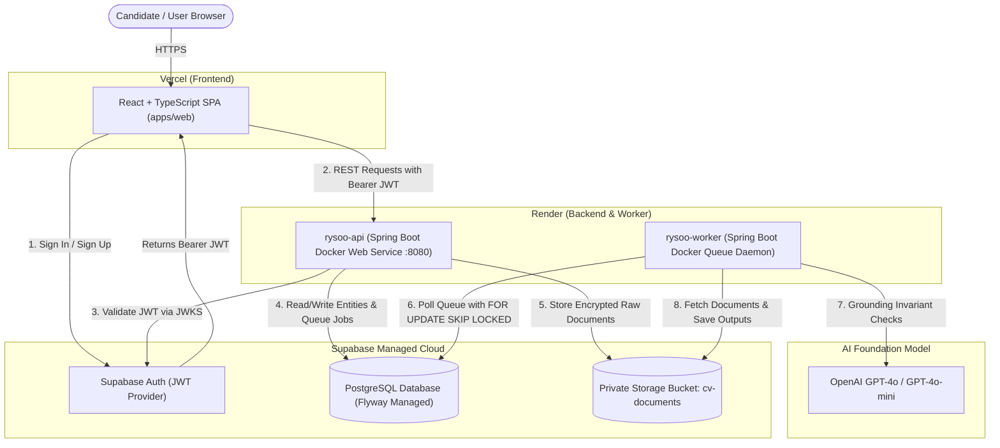

# Complete Setup & Connection Guide: Render, Vercel & Supabase
**Rysoo CV Optimization Platform**

This guide provides a comprehensive, step-by-step walkthrough for deploying and interconnecting the entire Rysoo monorepository across **Supabase** (Database, Auth, Storage), **Render** (Dockerized Spring Boot REST API & Background Worker), and **Vercel** (React Web Application).

---

## Architecture Topology



---

## Prerequisites & Required Accounts

Before beginning, ensure you have active accounts on:
1. [GitHub](https://github.com/) (with repository [`theb0imanuu/rysoo`](https://github.com/theb0imanuu/rysoo.git))
2. [Supabase](https://supabase.com/)
3. [Render](https://render.com/)
4. [Vercel](https://vercel.com/)
5. [OpenAI Platform](https://platform.openai.com/) (API Key with GPT-4o access)

---

## Phase 1: Supabase Setup (Database, Auth, and Storage)

Supabase provides the managed PostgreSQL database, authentication service, and private object storage.

### 1.1 Create a New Supabase Project
1. Log in to [Supabase](https://supabase.com/dashboard) and click **New project**.
2. Select an organization and enter:
   - **Name**: `rysoo` (or `rysoo-production`)
   - **Database Password**: Generate and securely save a strong password (you will need this for Render).
   - **Region**: Choose a region close to your Render deployment (e.g., `US East (N. Virginia)` or `US West (Oregon)`).
3. Click **Create new project** and wait ~2 minutes for provisioning to finish.

### 1.2 Retrieve API Keys & Project URLs
1. Navigate to **Project Settings** (gear icon in left sidebar) > **API**.
2. Copy and save the following values:
   - **Project URL**: `https://<your-project-ref>.supabase.co`
   - **anon / public key**: `eyJhbGciOi...` (used by Vercel frontend)
   - **service_role key** (Secret): `eyJhbGciOi...` (click reveal; used exclusively by Render backend)

### 1.3 Retrieve PostgreSQL Database Connection Details (CRITICAL: IPv4 vs IPv6)
> [!IMPORTANT]
> **Render IPv6 Gotcha**: Newer Supabase projects assign **IPv6-only** addresses to the direct host (`db.<project-ref>.supabase.co`). Render Web Services do **not** support IPv6 outbound routing by default. If you use the direct host from Render, your connection will fail with `UnknownHostException` or `Connection timed out`.
>
> **The Solution**: You MUST use the **Supabase Connection Pooler** (which resolves over IPv4).

1. In Supabase Dashboard, go to **Project Settings** > **Database**.
2. Scroll to **Connection Pooling** (or **Connection String** > **URI / JDBC**):
   - **Mode**: Select **Session** (recommended for Spring Boot + Flyway on Port `5432`) or **Transaction** (Port `6543`).
   - **Host**: `aws-0-<region>.pooler.supabase.com` (e.g., `aws-0-us-west-1.pooler.supabase.com`).
   - **Port**: `5432` (Session mode) or `6543` (Transaction mode).
   - **User**: `postgres.<your-project-ref>` (Note the dot and project ref suffix!).
   - **Database**: `postgres`
   - **Password**: Your database password.
3. Your exact Render JDBC connection string should be:
   ```text
   jdbc:postgresql://aws-0-<region>.pooler.supabase.com:5432/postgres?sslmode=require
   ```

### 1.4 Disable Email Confirmation for Initial Testing (Recommended)
By default, Supabase requires users to click an email verification link before their session token is issued.
1. In the Supabase sidebar, go to **Authentication** > **Providers** > **Email**.
2. Toggle **Confirm email** to **OFF** (Disabled).
3. Click **Save**.
*(You can re-enable this later when you configure custom SMTP via Resend, SendGrid, or AWS SES).*

### 1.5 Create the Private Document Storage Bucket
1. In the Supabase sidebar, click **Storage**.
2. Click **New bucket**.
3. Enter bucket configuration:
   - **Name**: `cv-documents`
   - **Public bucket**: **DISABLED / OFF** (Strict Option A security requirement: documents must remain strictly private).
4. Click **Save bucket**.

### 1.6 Database Schema Migration & Auth Trigger
Rysoo requires 10 application tables and a trigger on `auth.users` so that user profiles are created automatically upon signup:

1. In the Supabase sidebar, open the **SQL Editor**.
2. Open [`supabase/migrations/20261020000001_initial_schema.sql`](file:///c:/Users/MANU/Desktop/rysoo/supabase/migrations/20261020000001_initial_schema.sql).
3. Copy the entire file content, paste it into the Supabase SQL Editor, and click **Run**.
4. This creates:
   - 10 application tables (`profiles`, `cv_documents`, `cv_versions`, `job_descriptions`, `optimization_projects`, `optimization_runs`, `optimization_results`, `export_files`, `usage_ledger`, `processing_jobs`).
   - The `on_auth_user_created` trigger which automatically copies new signups from `auth.users` into `public.profiles` (preventing foreign key violation errors on first upload).

---

## Phase 2: Render Setup (Backend API & Worker Services)

The backend runs as two Docker containers built from the multi-stage [`Dockerfile`](file:///c:/Users/MANU/Desktop/rysoo/Dockerfile):
- `rysoo-api` (Spring Boot Web Service handling REST endpoints)
- `rysoo-worker` (Spring Boot Background Worker consuming the durable queue)

### 2.1 Connect Render to GitHub
1. Log in to [Render Dashboard](https://dashboard.render.com/).
2. If this is your first time, link your GitHub account and grant access to [`theb0imanuu/rysoo`](https://github.com/theb0imanuu/rysoo.git).

### 2.2 Deploy via Render Blueprint (Recommended)
The repository includes an infrastructure blueprint ([`render.yaml`](file:///c:/Users/MANU/Desktop/rysoo/render.yaml)) that configures both services together.

1. In the Render Dashboard, click **New +** > **Blueprint**.
2. Select your repository: `theb0imanuu/rysoo`.
3. Render will detect [`render.yaml`](file:///c:/Users/MANU/Desktop/rysoo/render.yaml) and show:
   - **`rysoo-api`** (Web Service)
   - **`rysoo-worker`** (Background Worker)
4. Click **Apply**.
5. Render will prompt you to enter the environment variables (see below).

---

### 2.3 Required Environment Variables on Render

Configure these environment variables for **both** `rysoo-api` and `rysoo-worker` (or use a shared **Render Environment Group**):

| Environment Variable | Value / Description | Example / Required Format |
| :--- | :--- | :--- |
| `SPRING_PROFILES_ACTIVE` | Set to `render` on API, `render,worker` on Worker | `render` |
| `SPRING_DATASOURCE_URL` | Supabase IPv4 Pooler Session URL (**Never use direct host on Render**) | `jdbc:postgresql://aws-0-eu-west-1.pooler.supabase.com:5432/postgres?sslmode=require` |
| `SPRING_DATASOURCE_USERNAME` | Supabase pooler user (Must include `.<project-ref>`) | `postgres.polbulragrgkfjyadnqc` |
| `SPRING_DATASOURCE_PASSWORD` | Supabase database password | `<your-db-password>` |
| `SUPABASE_URL` | Supabase Project URL | `https://polbulragrgkfjyadnqc.supabase.co` |
| `SUPABASE_JWT_ISSUER` | Supabase JWT issuer URL | `https://polbulragrgkfjyadnqc.supabase.co/auth/v1` |
| `SUPABASE_STORAGE_BUCKET` | Storage bucket name | `cv-documents` |
| `SUPABASE_SERVICE_ROLE_KEY` | Supabase Service Role Secret Key | `eyJhbGciOi...` |
| `AI_PRIMARY_PROVIDER` | AI model provider | `openai` |
| `OPENAI_API_KEY` | OpenAI API key | `sk-proj-...` |
| `CORS_ALLOWED_ORIGINS` | Permitted frontend origins (comma-separated) | `http://localhost:3000,https://rysoo.vercel.app` (update once Vercel is created) |

---

### 2.4 Enable Continuous Deployment (Deploy Hooks)

To enable automatic zero-downtime deployment whenever you push to GitHub:
1. In the Render Dashboard, open **`rysoo-api`** > **Settings**.
2. Scroll to **Deploy Hook** and click **Create Deploy Hook**.
3. Copy the generated Webhook URL (format: `https://api.render.com/deploy/srv-...`).
4. Repeat for **`rysoo-worker`** > **Settings** > **Create Deploy Hook**.
5. Go to your GitHub repository: [`https://github.com/theb0imanuu/rysoo/settings/secrets/actions`](https://github.com/theb0imanuu/rysoo/settings/secrets/actions).
6. Click **New repository secret** and add:
   - `RENDER_API_DEPLOY_HOOK_URL`: Paste the `rysoo-api` hook URL.
   - `RENDER_WORKER_DEPLOY_HOOK_URL`: Paste the `rysoo-worker` hook URL.

Now, whenever code is pushed to `main`, GitHub Actions will build the container images and trigger Render deployment automatically!

### 2.5 Verify Backend Health
Once Render completes building and running the container:
- Visit your Render API URL: `https://<your-api-service>.onrender.com/actuator/health`
- Expected response: `{"status":"UP"}`
- Interactive OpenAPI documentation: `https://<your-api-service>.onrender.com/swagger-ui.html`

---

## Phase 3: Vercel Setup (React Web Frontend)

The web frontend is located in [`apps/web`](file:///c:/Users/MANU/Desktop/rysoo/apps/web) and uses React 18, TypeScript, and Vite.

### 3.1 Import Project into Vercel
1. Log in to [Vercel](https://vercel.com/dashboard).
2. Click **Add New...** > **Project**.
3. Select your GitHub repository: `theb0imanuu/rysoo`.

### 3.2 Configure Monorepo Root Directory & Build Settings
In the **Configure Project** screen:
1. **Framework Preset**: Select `Vite` (Vercel will usually auto-detect this).
2. **Root Directory**: Click **Edit** and select `apps/web`.
3. **Build and Output Settings**:
   - **Build Command**: `npm run build`
   - **Output Directory**: `dist`
   - **Install Command**: `npm install`

### 3.3 Set Frontend Environment Variables
In the **Environment Variables** section on Vercel, add the following 3 variables:

| Variable Name | Value | Purpose |
| :--- | :--- | :--- |
| `VITE_SUPABASE_URL` | `https://<your-project-ref>.supabase.co` | Connects web client to Supabase Auth |
| `VITE_SUPABASE_ANON_KEY` | `<your-supabase-anon-key>` | Public client anonymous key |
| `VITE_API_BASE_URL` | `https://<your-api-service>.onrender.com` | Public URL of your Render Spring Boot API (omit trailing slash) |

Click **Deploy**. Vercel will install dependencies, build the production bundle, and assign a production URL (e.g., `https://rysoo.vercel.app` or `https://rysoo-manus-projects.vercel.app`).

---

## Phase 4: Interconnection & CORS Configuration

Now that both Render and Vercel are deployed, connect the loop by allowing CORS and configuring redirect URLs.

### 4.1 Update CORS on Render
1. Open the Render Dashboard > **`rysoo-api`** > **Environment**.
2. Locate `CORS_ALLOWED_ORIGINS`.
3. Append your production Vercel domain, for example:
   ```text
   http://localhost:3000,https://rysoo.vercel.app,https://rysoo-manus-projects.vercel.app
   ```
4. Click **Save Changes**. Render will automatically restart the web service with updated CORS policies.

### 4.2 Configure Supabase Authentication Redirects
1. Go to the Supabase Dashboard > **Authentication** > **URL Configuration**.
2. Set **Site URL** to your Vercel deployment URL:
   ```text
   https://rysoo.vercel.app
   ```
3. In **Redirect URLs**, add:
   - `http://localhost:3000/*` (for local development)
   - `https://rysoo.vercel.app/*`
   - `https://*-your-team.vercel.app/*` (for preview deployments)
4. Click **Save**.

---

## Phase 5: Verification & End-to-End Walkthrough

Follow this 5-step test checklist to confirm the entire stack is functioning seamlessly:

1. **Authentication Flow**:
   - Open your Vercel web application URL.
   - Click **Sign In / Sign Up** and register a new test user account.
   - Confirm that the session token is issued by Supabase Auth and visible in browser storage.
2. **Backend API Authorization Check**:
   - Open browser developer tools > **Network** tab.
   - When viewing the Dashboard, observe the request to `GET /api/v1/cv`.
   - Verify that the request header contains `Authorization: Bearer <JWT>` and returns `200 OK`.
3. **Document Ingestion (Magic-byte & Extraction)**:
   - Click **Upload CV** in the web studio.
   - Upload a sample PDF or DOCX file.
   - Verify that the document is parsed, normalized into markdown, and stored securely.
4. **Optimization & Grounding Execution**:
   - Paste a target job description and click **Optimize CV**.
   - Check the **Audit Panel**: Confirm that match scores, skills, and grounded accomplishments are rendered with verified factual evidence badges.
5. **Durable Worker Verification**:
   - In Render Dashboard > **`rysoo-worker`** > **Logs**, verify that the queue poller is active:
     ```text
     Polling processing_jobs queue with status=QUEUED...
     Claimed job [id=...]: processing optimization run
     Job completed successfully in ...ms
     ```

---

## Troubleshooting Guide

| Issue | Root Cause | Solution |
| :--- | :--- | :--- |
| `HikariPool-1 - Connection refused` | Incorrect DB host, port, or missing `sslmode=require` | Verify `SPRING_DATASOURCE_URL` contains `?sslmode=require`. If using Supabase transaction pooler, ensure port is `6543` and user is `postgres.<ref>`. |
| `401 Unauthorized: Invalid JWT` | `SUPABASE_JWT_ISSUER` does not match the token's `iss` claim | Verify `SUPABASE_JWT_ISSUER` is formatted as `https://<ref>.supabase.co/auth/v1` without trailing slashes. |
| `CORS Error: No 'Access-Control-Allow-Origin' header` | Render backend does not recognize the Vercel URL | Add your exact Vercel URL (including `https://`) to `CORS_ALLOWED_ORIGINS` in Render environment settings. |
| `StorageException: Bucket cv-documents not found` | The private storage bucket was not created | In Supabase Dashboard > Storage, create a bucket named `cv-documents` (private). |
| `Build failed in Vercel: Missing root directory` | Vercel tried building from the root instead of `apps/web` | In Vercel Project Settings > General, set Root Directory to `apps/web`. |

---

## Summary of Environment Secrets Checklist

Store these in your secure password manager or CI vault:

```env
# ------------------------------------------------------------------------------
# SUPABASE
# ------------------------------------------------------------------------------
SUPABASE_URL=https://polbulragrgkfjyadnqc.supabase.co
SUPABASE_ANON_KEY=eyJhbGciOi...
SUPABASE_SERVICE_ROLE_KEY=eyJhbGciOi...
SUPABASE_DB_URL=jdbc:postgresql://aws-0-eu-west-1.pooler.supabase.com:5432/postgres?sslmode=require
SUPABASE_DB_USER=postgres.polbulragrgkfjyadnqc
SUPABASE_DB_PASSWORD=<secure-password>

# ------------------------------------------------------------------------------
# RENDER (Backend Environment Group for rysoo-api and rysoo-worker)
# ------------------------------------------------------------------------------
SPRING_PROFILES_ACTIVE=render
SPRING_DATASOURCE_URL=jdbc:postgresql://aws-0-eu-west-1.pooler.supabase.com:5432/postgres?sslmode=require
SPRING_DATASOURCE_USERNAME=postgres.polbulragrgkfjyadnqc
SPRING_DATASOURCE_PASSWORD=<your-db-password>
SUPABASE_URL=https://polbulragrgkfjyadnqc.supabase.co
SUPABASE_JWT_ISSUER=https://polbulragrgkfjyadnqc.supabase.co/auth/v1
SUPABASE_STORAGE_BUCKET=cv-documents
SUPABASE_SERVICE_ROLE_KEY=eyJhbGciOi...
AI_PRIMARY_PROVIDER=openai
OPENAI_API_KEY=sk-proj-...
CORS_ALLOWED_ORIGINS=http://localhost:3000,https://rysoo.vercel.app

# ------------------------------------------------------------------------------
# VERCEL (apps/web Environment Variables)
# ------------------------------------------------------------------------------
VITE_SUPABASE_URL=https://<your-project-ref>.supabase.co
VITE_SUPABASE_ANON_KEY=eyJhbGciOi...
VITE_API_BASE_URL=https://rysoo-api.onrender.com

# ------------------------------------------------------------------------------
# GITHUB ACTIONS (Repository Secrets)
# ------------------------------------------------------------------------------
RENDER_API_DEPLOY_HOOK_URL=https://api.render.com/deploy/srv-xxxxx
RENDER_WORKER_DEPLOY_HOOK_URL=https://api.render.com/deploy/srv-yyyyy
```
